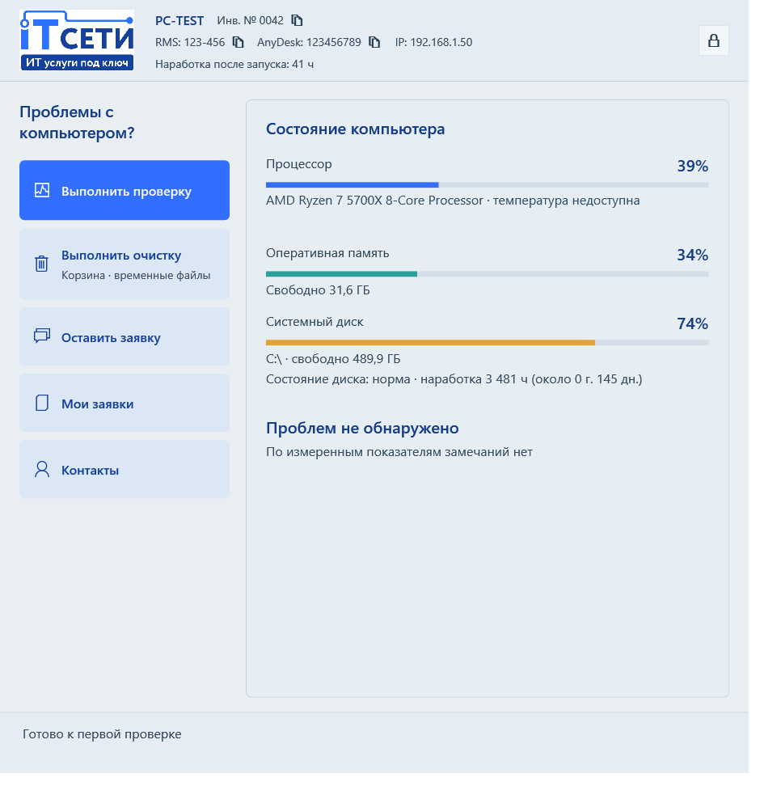
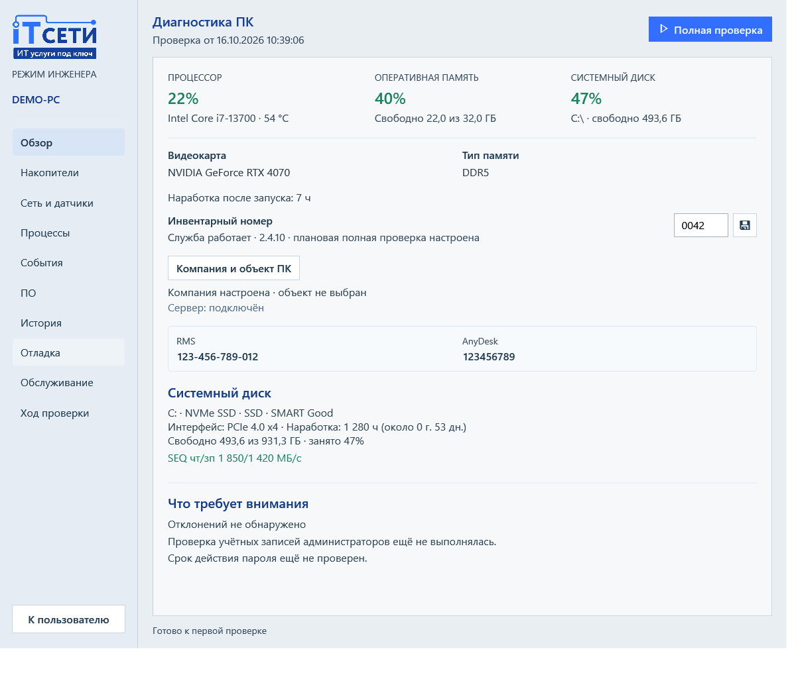

<div align="center">
  
  <h1>Обслуживание ПК ИТ-Сети</h1>
  <p>Диагностика компьютеров, обслуживание Windows и связь с технической поддержкой</p>
  <p>
    <a href="ITSeti.Maintenance/README.md">Техническая документация клиента</a>
    · <a href="ITSeti.Server/README.md">Центральный сервер</a>
    · <a href="ITSeti.Maintenance/THIRD-PARTY-NOTICES.md">Сторонние компоненты</a>
  </p>
</div>

Приложение собирает сведения о состоянии компьютера, помогает выполнить диагностику и очистку, а инженеру даёт инструменты обслуживания. После подключения к центральному серверу компьютер, отчёты и заявки доступны в общей панели.

Текущая версия клиента: **2.4.9**. Для Windows 7 публикуется отдельный совместимый установщик.





## Как устроена работа

В приложении есть пользовательский интерфейс, фоновая служба Windows и центральный сервер.

- **Интерфейс** показывает состояние ПК, результаты проверок, историю и инструменты для пользователя или инженера.
- **Служба Windows** устанавливается вместе с приложением, запускается автоматически от `LocalSystem` и выполняет фоновые задачи, которым нужны системные права. Она собирает текущие показатели, управляет диагностическими операциями и сохраняет их состояние, пока окно приложения закрыто.
- **Центральный сервер** хранит зарегистрированные компьютеры, отчёты, критические события, каталог программ и заявки. При недоступности сервера локальная диагностика и история остаются доступны; серверные функции временно не работают.

Служба получает поддерживаемые датчики через HWiNFO и передаёт интерфейсу последнее сохранённое состояние. Показатели обновляются в фоне примерно раз в пять секунд; датчики, которые конкретное оборудование или HWiNFO не предоставляют, отображаются как недоступные, а не подменяются показаниями другого компонента. SMART обновляется отдельно, реже текущих показателей.

Полная проверка сохраняет конфигурацию компьютера: имя, процессор, объём и тип памяти, видеокарту, ОС, BIOS, накопители и сетевые адаптеры. В серверной панели состояние мониторинга и ошибки приложения сгруппированы по компьютерам. Подтверждённые измерения CPU, памяти и доступных датчиков HWiNFO хранятся за последние пять минут и могут быть показаны на графике рядом с событием. Для каждой проблемы доступны отметка о решении и подтверждаемое игнорирование этого типа проблемы на конкретном ПК. Фильтры позволяют выбрать несколько видов проблем; по умолчанию показаны все. Кнопка «Назад» возвращает к предыдущему разделу, компьютеру и выбранным фильтрам.

На странице «Сеть и датчики» показаны карточки доступных температур и напряжений. Для процессора используется агрегированная температура, отдельные ядра не загромождают экран. Аппаратные флаги HWiNFO разбираются отдельно: перегрев, ограничения питания и неисправности компонентов получают пояснения в результатах диагностики. Цветовые пороги, настроенные только в окне HWiNFO, не считаются аппаратными флагами.

Мониторинг подтверждает тревогу по новым измерениям: напряжение — после 3 показаний за минуту, температура — после 6, загрузка CPU и ОЗУ — после 8. Отчёты и критические события отправляются не чаще одного раза в час; ответ сервера с отчётом содержит актуальный каталог ПО. Если очередь отчётов пуста, служба раз в час получает каталог отдельным запросом и сохраняет его для работы без сети. Обычные изменения нагрузки не превращаются в отдельные постоянные серверные сообщения.

## Пользовательский режим

### Проверка

Кнопка **«Выполнить проверку»** запускает диагностику компьютера: состояние процессора и памяти, доступные датчики, накопители и SMART, скорость системного диска, сеть, процессы и важные события Windows. Приложение показывает ход работы и сохраняет результат в локальную историю. Проверка не запускает очистку: для неё есть отдельная кнопка.

Закрытие окна во время проверки скрывает интерфейс до её завершения. Проверка продолжает работу и сохраняет результат. При обновлении приложение закрывается после проверки установщика и открывается в пользовательской сессии после установки; окно ожидания можно закрыть.

В сводке отображаются найденные замечания, последние доступные показатели и системный диск. Если место заканчивается, можно открыть TreeSize и посмотреть, какие папки занимают пространство. Неисправность или ограничение несистемного диска показывается инженеру, а не загромождает пользовательскую сводку.

### Очистка

Кнопка **«Очистить»** запускает очистку поддерживаемых временных данных пользователя и Windows. Пользовательская и системная части выполняются раздельно: системную часть обрабатывает служба с повышенными правами. Итог и подробности операции можно посмотреть в инженерском режиме.

Очистка не предназначена для удаления документов, загрузок и личных файлов. Проверка, очистка и восстановление Windows — отдельные операции.

### Поддержка и заявки

Из окна помощи можно создать заявку, указать контакт, описать проблему и приложить файлы. Данные компьютера при необходимости прикладываются отдельно от текста обращения. В разделе **«Мои заявки»** доступны статусы, переписка, вложения и ссылка на заявку в Okdesk.

Системная служба проверяет ответы по активным заявкам и сохраняет их, даже когда окно приложения закрыто. При новом ответе служба показывает короткое сообщение в активном сеансе Windows через системный механизм уведомлений; отдельный процесс уведомителя не нужен. Пока активных заявок нет, опрос приостанавливается до создания заявки или ручного обновления.

## Инженерский режим

Инженерский режим открывается из основного окна. В нём находятся подробные сведения о ПК, дополнительная диагностика и административные инструменты. Операции, требующие системного уровня доступа, передаются установленной службе; доступность отдельных действий также зависит от Windows и политик организации.

| Раздел | Назначение |
| --- | --- |
| **Обзор** | Идентификаторы компьютера, инвентарный номер, показатели и сведения, требующие внимания. Здесь задаются компания и объект ПК, если сервер не смог определить их автоматически. |
| **Накопители** | Физические диски, разделы, SMART, состояние накопителя и результаты тестов. |
| **Сеть и датчики** | Сетевые адаптеры, MAC- и IP-адреса, скорость соединения и последние значения датчиков HWiNFO. |
| **Процессы** | Список процессов, сведения об издателе и подписи. Инженер может разрешить процесс или доверять проверенному издателю; правила применяются через серверную политику. |
| **События** | События Windows с фильтрами по уровню и просмотром подробностей. |
| **ПО** | Состояние установленных компонентов, установка программ из серверного каталога, запуск CrystalDiskInfo, CrystalDiskMark, TreeSize и HWiNFO. В этом же разделе находится получение обновления приложения с сервера. |
| **История** | Ранее сохранённые проверки и сравнение доступных показателей между запусками. |
| **Отладка** | Зарегистрированные ошибки приложения и операций, технические сведения и файлы журналов для разбора сбоев. |
| **Обслуживание** | Очистка, системные средства Windows, проверка и настройки обновлений Windows, Microsoft Defender, DISM и SFC. Некоторые изменения могут быть запрещены политикой организации. |
| **Ход проверки** | Этапы и текущий результат выполняемой диагностики или обслуживания. |

## Центральный сервер и Okdesk

Приложение подключается к центральному серверу ИТ-Сети. При регистрации сервер пытается сопоставить компьютер с известной записью по доступным идентификаторам и инвентарному номеру. Если компанию и объект определить не удалось, инженер может выбрать их в приложении. Выбор сохраняется для этого компьютера.

В серверной панели доступны список компьютеров, их компания и объект, диагностические отчёты, история, критические события, политика разрешённых процессов, каталог ПО и заявки. Сетевые адреса и аппаратные сведения включаются в диагностические данные компьютера.

Сервер синхронизирует каталог оборудования, статусы, публичные сообщения и вложения Okdesk через настроенный на сервере транспорт. Клиент создаёт заявку через центральный сервер; статус её доставки и переписка затем возвращаются в приложение. Учётные данные интеграции хранятся на сервере и не должны помещаться в исходный код или README.

Windows 7 поставляется отдельной совместимой сборкой. Набор функций зависит от версии Windows; интерфейс заявок в Windows 7 отсутствует.

## Данные и журналы

Для работы приложение сохраняет историю, состояние службы, кэш датчиков и журналы. Типичные расположения:

- пользовательская история и контакт для заявки: `%LOCALAPPDATA%\ITSeti\Maintenance`;
- данные и журналы службы, отчёты запусков и кэш HWiNFO: `%ProgramData%\ITSeti\Maintenance`;
- журнал установки: `%ProgramData%\ITSeti\Maintenance\install.log`.

При подключении к серверу по HTTPS передаются необходимые для учёта и диагностики сведения: идентификаторы компьютера, отчёты, сетевые адреса, критические состояния и краткие сведения об ошибках приложения. Текст заявки и выбранные вложения передаются, когда пользователь отправляет обращение. Серверные функции не требуют размещать пароли Okdesk в клиентской сборке.

## Установка

Установщик запускается с правами администратора: это необходимо для установки и настройки системной службы и плановых заданий Windows. После установки обычный пользователь может открыть приложение из меню «Пуск». Если компьютер уже зарегистрирован и сопоставлен на сервере, повторно указывать подключение не требуется.

Для Windows 10/11 используется x64-сборка. Для Windows 7 SP1 предусмотрен отдельный установщик x86 или x64; часть новых функций Windows 10/11 в нём недоступна. Условия использования входящих в комплект сторонних программ перечислены в [уведомлениях о сторонних компонентах](ITSeti.Maintenance/THIRD-PARTY-NOTICES.md).

## Сборка из исходников

Откройте `ITSeti.Maintenance/ITSeti.Maintenance.sln` в Visual Studio 2022 с .NET 9 SDK или выполните из корня репозитория:

```powershell
dotnet build ITSeti.Maintenance/ITSeti.Maintenance.sln -c Release
dotnet run --project ITSeti.Maintenance/tests/ITSeti.Maintenance.Smoke
powershell.exe -NoProfile -ExecutionPolicy Bypass -File ITSeti.Maintenance/Build-InstallPackage.ps1
```

Для сборки установщика также нужен Inno Setup 6. Подробности реализации клиента и тестирования находятся в [технической документации](ITSeti.Maintenance/README.md); инструкции по развёртыванию сервера — в [README сервера](ITSeti.Server/README.md).
